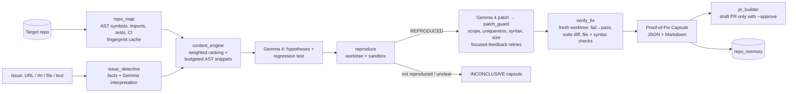

# OSS Forge

**Turn unfamiliar repositories into verified, review-ready open-source contributions using Gemma 4.**

OSS Forge is an [Agent Skill](https://agentskills.io/specification) (`.agents/skills/oss-forge/SKILL.md`)
backed by a Python CLI. Give it a repository and an issue; it maps the code, picks the few definitions that
matter, has hosted **Gemma 4** (`gemma-4-26b-a4b-it` via the Gemini API) diagnose the bug and write a
regression test, reproduces the failure in an isolated git worktree, applies a minimal guarded patch, verifies
it independently, and hands you a **Proof-of-Fix Capsule** and a PR draft where every claim points at real
test output.

> Built for MLH Hacktoberfest 2026 (Best Open-Source AI Project; Best Use of Gemma 4).

## Why

Maintainers don't need more AI-generated patches; they need patches they can trust quickly. Coding agents
already exist (Aider, SWE-agent, OpenHands, …). OSS Forge's angle is narrower and measurable:

1. **Right context, not most context.** Deterministic analysis (AST symbols, call/import graph, stack
   frames, error literals, git history) ranks definitions and packs only those into a hard token budget, so a
   compact open model gets useful context.
2. **Evidence over explanation.** A fix is only `VERIFIED` when a regression test fails on the base commit,
   passes with the patch, and the existing suite has no new failures, checked again in a fresh worktree.
3. **Honest abstention.** Unclear issues end as `INCONCLUSIVE` with the missing information listed, not a
   speculative patch.

## Architecture



| Layer | Modules |
|---|---|
| Model | `oss_forge/ai/gemma_provider.py` (google-genai, budgets, retries/backoff, RetryInfo, usage ledger, JSON repair), `ai/schemas.py` |
| Analysis | `analysis/repo_map.py`, `symbol_index.py` (Python AST, JS/TS scanner), `context_engine.py`, `repo_memory.py` |
| Workflows | `workflows/env_doctor.py`, `issue_detective.py`, `reproduce.py`, `patch_guard.py`, `verify_fix.py`, `capsule.py`, `pr_builder.py`, `ci_repair.py`, `maintainer.py`, `solve.py` (orchestration) |
| Safety | `security/execution_policy.py` (argv allowlist, scrubbed env, path confinement, Docker sandbox, redaction) |
| Skill | `.agents/skills/oss-forge/` (`SKILL.md`, `scripts/oss_forge.py`, `references/`) |

**Who does what:** Python does everything deterministic: parsing, ranking, git, running tests, checking
patches. Gemma 4 does the judgement calls: interpreting the issue, choosing suspects, forming hypotheses,
writing the regression test and the patch. Typical run: 3–5 Gemma calls.

## Install

```bash
git clone https://github.com/sahilkarande0918-cmd/OSS-Forge.git && cd OSS-Forge
python -m venv .venv
.venv/Scripts/pip install -e ".[dev]"        # Windows   (Linux/macOS: .venv/bin/pip)
cp .env.example .env                         # then put your key in .env
python -m oss_forge doctor                   # add --live for one real Gemma call
```

Get a Gemini API key at <https://aistudio.google.com/apikey> and set `GEMINI_API_KEY` in `.env` (never commit
it; `.env` is git-ignored). Key settings (`.env.example`): `OSS_FORGE_MODEL` (`gemma-4-26b-a4b-it` |
`gemma-4-31b-it`), `OSS_FORGE_MAX_CONTEXT_TOKENS` (12000), `OSS_FORGE_MAX_API_CALLS` (30),
`OSS_FORGE_MAX_PATCH_ATTEMPTS` (3), `OSS_FORGE_DRY_RUN` (true), `OSS_FORGE_THINKING` (minimal|high),
`OSS_FORGE_SANDBOX` (auto|docker|host).

## CLI

| command | API calls | what it does |
|---|---|---|
| `doctor [--live]` | 0 (1) | tools, key presence (never printed), sandbox availability |
| `map --repo R` | 0 | repository map (Markdown, or `--json`) |
| `context --repo R --issue I --budget N` | 0 | ranked symbols with reasons + packed context |
| `env --repo R` | 0 | environment doctor: versions, lockfiles, env-var names, approval-aware setup plan |
| `analyze --repo R --issue I [--execute]` | 2-4 | interpretation, hypotheses, regression test (+ reproduction) |
| `solve --repo R --issue I [--dry-run \| --execute] [--allow-host-exec]` | 3-8 | full pipeline → capsule + PR draft |
| `verify --run-id ID [--allow-host-exec]` | 0 | re-verify a stored run from its artifacts |
| `pr --run-id ID [--create --approve]` | 0 | show PR package; open a **draft** PR only with explicit approval |
| `memory --repo R` | 0 | persistent repository memory (with staleness) |
| `ci-repair --run-id ID --log F \| --pr N [--use-gemma]` | 0-1 | CI failure triage, local re-run |
| `triage --repo R` | 0 | maintainer mode: duplicates, complexity, automation candidates |
| `benchmark --suite smoke --mode context\|live` | 0 / many | baseline vs OSS Forge |
| `capsule-schema` / `validate-skill` | 0 | capsule JSON Schema / skill spec validation |

All commands accept `--json`, `--out DIR`, `--verbose`, `--model`, `--max-api-calls`, `--max-context-tokens`.
Exit codes: 0 verified/partial, 1 failed, 2 blocked, 3 inconclusive. Issues can be a GitHub URL, `#123`
(uses the repo's GitHub remote via `gh`), a `.md`/`.txt` file, or plain text.

## Agent Skill and OpenCode

The skill follows the Agent Skills spec and validates with the reference validator
(`agentskills validate .agents/skills/oss-forge` → `Valid skill`) and `python -m oss_forge validate-skill`.
`SKILL.md` tells the host agent when to activate, which commands to run in which order, how to read each
status, which actions need human approval, how to recover and when to stop.

Verified with **OpenCode 1.19.3**: `opencode debug skill` (run inside this repo) lists `oss-forge`, and
OpenCode's catalog includes `google/gemma-4-26b-a4b-it`. Not yet verified: a full OpenCode session running on
Gemma 4 (needs a key). Either way, the skill's analysis and patches come from OSS Forge's own Gemma 4 provider,
whatever model hosts the agent. See [references/OPENCODE.md](.agents/skills/oss-forge/references/OPENCODE.md).

## Demo

See [docs/DEMO.md](docs/DEMO.md) for a judge-ready walkthrough on the bundled `shopkit` repository:
unfamiliar repo → bug report → repo map → ranked context → reproduced failure → minimal patch → verified fix →
capsule → PR draft → token/API metrics.

```bash
python -m oss_forge context --repo benchmarks/cases/shopkit/repo --issue examples/issue-checkout-tax.md --budget 2500
python -m oss_forge solve   --repo <git copy of shopkit> --issue examples/issue-median.md --execute --allow-host-exec
```

## Benchmark

Harness: [`benchmarks/benchmark_runner.py`](benchmarks/benchmark_runner.py); cases:
[`benchmarks/cases/cases.json`](benchmarks/cases/cases.json). Four issues on `shopkit` (a 14-module Python
package): A logic bug, B multi-file bug (the obvious-looking fix in `pricing.py` breaks existing tests; the
correct fix is in `checkout.py`), C an unclear report that must be declined, D a bug where unrelated files
must stay untouched. Each fixable case is graded by a **hidden oracle test** neither system sees.

**Context selection (no API calls, reproducible; budget 2500 tokens, repo ≈ 5,277 tokens).** Measured
2026-10-18, `python -m oss_forge benchmark --suite smoke --mode context --budget 2500`:

| case | OSS Forge: ground truth in context (rank) / tokens | path-order truncation | keyword-grep whole files |
|---|---|---|---|
| A median | yes (#1) / 2001 | no / 2487 | yes / 2416 |
| B checkout tax | yes (#2) / 2408 | yes / 2487 | yes / 2275 |
| D slugify | yes (#2) / 1601 | no / 2487 | no / 2321 |

At 1500 tokens: OSS Forge 3/3, path-order 1/3, grep 2/3; at 4000: OSS Forge 3/3 (≤2408 tokens used), path-order
2/3, grep 3/3 (3019–3789 tokens). Raw data: [`benchmarks/results/`](benchmarks/results/).

**End-to-end vs baseline (live Gemma 4): not yet run.** The harness is implemented and tested (`--mode live`
measures localization, reproduction, oracle-verified fix rate, false success claims, abstention, unrelated
edits, API calls, input/output tokens, context tokens and runtime). It needs `GEMINI_API_KEY`:
`python -m oss_forge benchmark --suite smoke --mode live --allow-host-exec`. Results will be committed as
produced, including cases where OSS Forge does worse.

Limitations: one small synthetic repository; token counts in the context suite are estimates (chars/4);
live token counts come from the API's `usage_metadata`.

## Security

Repository code is treated as untrusted. Tests run in a network-less Docker container when available, and
otherwise only with `--allow-host-exec` (explicit human approval). Every subprocess is a fixed argv from an
allowlist; model output is never executed. Edits are confined to files the model was shown, never tests,
build or CI files, and never paths outside the worktree. Credentials are scrubbed from child environments and
redacted from prompts, logs and capsules. Your checkout is never modified; pushes and draft PRs require
`--create --approve`, and OSS Forge never merges or force-pushes. Honest limits (host mode is not a sandbox;
the Docker image has only pytest, so repos with dependencies are BLOCKED there) are in
[references/SECURITY.md](.agents/skills/oss-forge/references/SECURITY.md). **Do not point it unattended at
hostile repositories.**

## Supported languages

Repository mapping and context ranking work for Python (AST) and JavaScript/TypeScript (brace-aware
scanner; tree-sitter would be more precise). Reproduction and verification are implemented for pytest; JS
test frameworks are detected but not yet executed.

## Model and licensing

OSS Forge's code is licensed under [Apache-2.0](LICENSE). Gemma 4 is used as a hosted model through the Gemini
API and is governed by Google's separate terms; see [docs/MODEL_TERMS.md](docs/MODEL_TERMS.md). OSS Forge does
not download or redistribute model weights.

Dependencies: `google-genai`, `pydantic`, `pytest` (runtime); `ruff`, `skills-ref` (dev).

## Status

| capability | status |
|---|---|
| Agent Skill (spec-valid, OpenCode discovery) | done, verified |
| Gemma 4 provider (budgets, retries, usage, JSON repair) | done; live inference against `gemma-4-26b-a4b-it` verified (`doctor --live`) |
| Repo map, context engine, env doctor | done, tested |
| Issue detective, reproduction, patch guard, verification, capsule, PR builder | done, tested end-to-end with scripted model replies and real git/pytest |
| Live end-to-end on Gemma 4, live benchmark | pending `GEMINI_API_KEY` |
| CI repair | triage + local re-run + advisory Gemma analysis; no automatic corrective patch |
| Repository memory, maintainer mode | done, tested |
| JS/TS test execution, project-specific Docker images | roadmap |

## Roadmap

- Run and publish the live Gemma 4 benchmark; add real-world issues from public repositories.
- tree-sitter parsing; Jest/Vitest reproduction; per-project Docker images with dependencies.
- Corrective patches for CI failures through the same guard + verification loop.

## Contributing

See [CONTRIBUTING.md](CONTRIBUTING.md). Run `python -m pytest` (`-m live` for the Gemma tests with a key).
